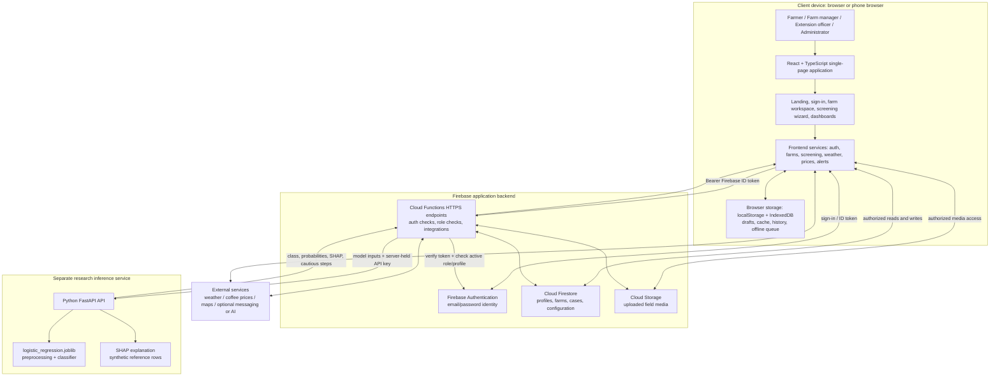
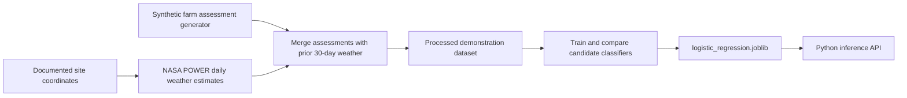
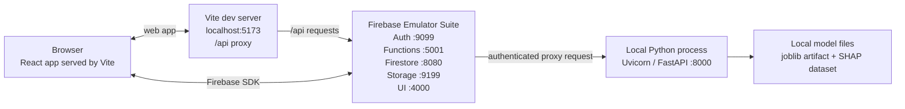
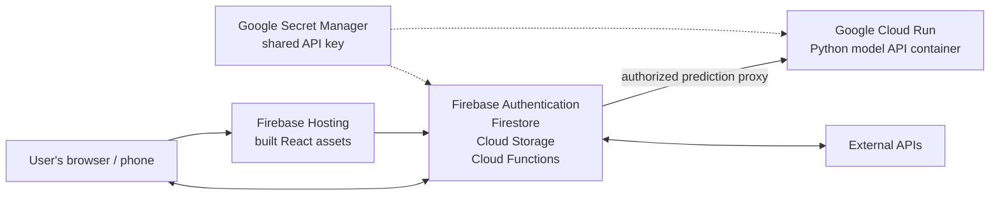

# AgriSense-BCTB Project Architecture

This document describes the architecture you can present to a panel: what the application does, where its parts run, how a model prediction travels through the system, and the limits of the current research model.

## 1. One-sentence overview

AgriSense-BCTB is a React web application for coffee farmers and agricultural extension teams. It combines Firebase identity and data services, local/offline field workflows, and a separate Python machine-learning API for research-only BCTB risk screening. In the current setup, that API runs locally; Cloud Run is the documented production target.

## 2. Logical architecture



### What each layer is responsible for

1. **Client application:** Presents the workflows and collects inputs. The BCTB screening page validates seven required answers plus optional symptom, farm-context, and field-measurement values before sending model factors to inference.
2. **Frontend services:** Keep UI components separate from network and persistence details. They call Firebase directly for permitted data operations and call Functions for protected server-side operations.
3. **Browser storage:** Keeps user-scoped drafts, caches, history, and offline work on the device. It is not the same as a cloud database and is not automatically visible on another device.
4. **Firebase Authentication:** Creates and authenticates accounts. Firestore stores the user profile and application data; Storage stores supported uploaded files.
5. **Cloud Functions:** Act as trusted server-side endpoints. For protected operations they verify the Firebase ID token, load the user's profile/role, and enforce authorization before continuing.
6. **Python model API:** Loads the serialized scikit-learn pipeline and computes the research prediction and explanation. The browser does not call this API directly.
7. **External services:** Supply optional capabilities such as weather, coffee price data, map suggestions, and configured messaging/AI integrations. These are integrations, not part of the trained model.

## 3. BCTB prediction request: end-to-end sequence

```mermaid
sequenceDiagram
    actor Farmer
    participant UI as React screening wizard
    participant Client as researchBctbModelService
    participant Auth as Firebase Authentication
    participant Fn as predictResearchBctb Function
    participant API as Python FastAPI
    participant Artifact as Logistic Regression artifact

    Farmer->>UI: Complete screening and choose "Run research model prediction"
    UI->>Client: Submit required answers + all entered model factors/readings
    Client->>Auth: Read current user's Firebase ID token
    Auth-->>Client: Signed ID token
    Client->>Fn: POST /api/predictResearchBctb + Bearer token
    Fn->>Auth: Verify token; check active profile and permitted role
    Auth-->>Fn: Verified user and role
    Fn->>API: POST /predict + model inputs + server-held x-api-key
    API->>Artifact: Predict class probabilities
    API->>API: Calculate SHAP contributions and verification steps
    API-->>Fn: Class, probabilities, explanation, disclaimer
    Fn-->>Client: Prediction response
    Client->>Client: Validate response shape and probability values
    Client-->>UI: Typed research prediction
    UI-->>Farmer: Show risk class, probabilities, SHAP factors, and next steps
```

### Seven model inputs

- Observed twig dieback
- Suspected entry holes
- Reported affected twig count
- Previous BCTB report
- Farm sanitation
- Pruning frequency
- Recent pruning

The current expanded demo accepts 34 predictors: the seven required screening inputs, additional plant symptoms and management answers, weather readings, shade/vegetation context, coffee context, and sample counts/measurements. The inspection date is reduced to month; free-text notes stay on-device. Missing optional values are imputed. All labels remain synthetic.

### Security boundary in the prediction path

- The user signs in with Firebase; the frontend sends a Firebase ID token to the Function.
- The Function verifies the token and checks the user's active profile and role.
- The shared research-model API key is held by the Function and the Python API. It must not be put in a `VITE_` variable or sent to the browser.
- The Function proxies the request; it does not replace a failed model response with the older rules-based calculation.
- The current research prediction is displayed as a research result; it is not saved as a verified field outcome or a confirmed diagnosis.

## 4. Data and model-building pipeline



The training scripts generate **synthetic assessment rows and illustrative labels**; weather estimates do not provide verified farm-level BCTB outcomes. The selected Logistic Regression artifact demonstrates the training-to-inference software path, but it has not been validated as a real-world diagnostic or risk predictor. Its probabilities are not calibrated. SHAP describes contributions to the model's raw class score (log-odds) relative to synthetic reference rows; it does not establish biological causation.

## 5. Physical deployment view

### Current local development arrangement



For local development, `npm run dev` builds the Functions code, starts the Firebase emulators, and serves the React app. The Python API is a separate process that must also be running. The local emulator account/data set is separate from production Firebase. Emulator export/import keeps local development data on the development machine between runs.

### Intended production arrangement



**Deployment status to state accurately:** the frontend/Firebase project has local emulator configuration and Firebase Hosting/Functions deployment configuration. The model API is running locally when you start Uvicorn. Cloud Run is the documented production deployment option for the model API; unless you have separately deployed the container and configured its URL and secret, do not say the model is already deployed to Cloud Run.

## 6. How to explain it to a panel

> “AgriSense is an offline-first early-warning and decision-support prototype for Black Coffee Twig Borer in Ugandan Robusta coffee. The React frontend supports farmer, manager, extension, and administrator workflows. Firebase handles accounts and cloud data, while IndexedDB and local storage support offline field work. A screening submits required answers and every optional factor the farmer enters through an authenticated Firebase Function to a separate Python FastAPI service. The service runs a 34-feature scikit-learn pipeline, groups SHAP contributions back to the original inputs, maps influential observations to cautious non-chemical follow-up advice, and offers a constrained what-if explanation. The expanded model uses generated synthetic labels to demonstrate the end-to-end CS workflow; it still needs independent field validation before it can claim predictive value.”

### Useful distinction if asked “where is the model?”

- **Trained artifact:** `AgriSense_BCTB_Data_Retrieval/ml/models/logistic_regression.joblib`
- **Inference code:** `AgriSense_BCTB_Data_Retrieval/ml/api.py`
- **Local runtime:** Uvicorn on `127.0.0.1:8000`
- **Application gateway:** Firebase Function `predictResearchBctb`
- **Production target:** Cloud Run, after you build and deploy the container and configure the Function URL and secret

## 7. Main code landmarks

- Frontend bootstrap and providers: `src/main.tsx`
- App routing/authenticated workspace: `src/App.tsx`
- Firebase client and local emulator connection: `src/firebase/config.ts`
- Signup/login operations: `src/services/authservice.ts`
- BCTB form and model-input mapping: `src/pages/BctbAssessmentPage.tsx`
- Authenticated API request helper: `src/services/authenticatedFetch.ts`
- Prediction response validation: `src/services/researchBctbModelService.ts`
- Authenticated model proxy: `functions/src/index.ts`
- Model API and SHAP calculation: `AgriSense_BCTB_Data_Retrieval/ml/api.py`
- Training experiment: `AgriSense_BCTB_Data_Retrieval/ml/01_train_synthetic_models.py`
- Firebase local and Hosting configuration: `firebase.json`
