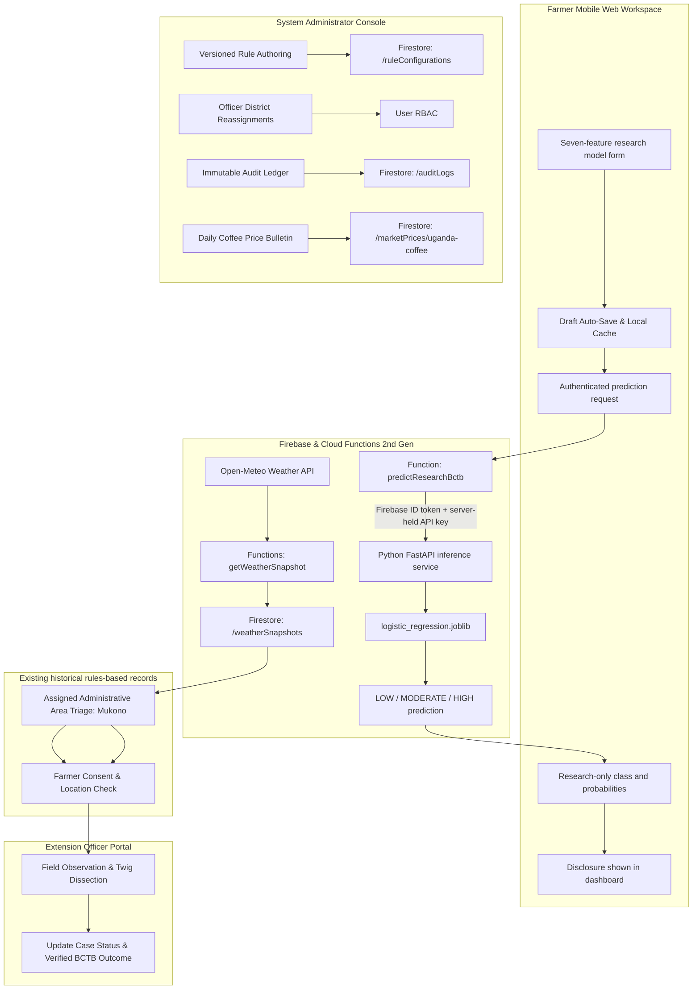

# AgriSense-BCTB: An Explainable AI Early-Warning System for Black Coffee Twig Borer Risk in Uganda

> **Project Definition:** An explainable, software-based early-warning and decision-support prototype for Black Coffee Twig Borer (BCTB) risk screening in Ugandan Robusta coffee plantations.

---

## 1. Domain & Agricultural Fundamentals

- **Target Pest:** Black Coffee Twig Borer (BCTB), ***Xylosandrus compactus*** (an **insect pest**, not a fungal or bacterial disease).
- **Damage Mechanism:** Adult female beetles bore into the underside of thin primary and secondary coffee branches, creating entrance holes (1 mm diameter) and introducing symbiotic ambrosia fungus (*Fusarium solani*). This fungal colonization blocks vascular sap flow, causing leaf chlorosis, twig blackening, wilting, and terminal branch dieback.
- **Target Crop:** Robusta coffee (***Coffea canephora***), Uganda's primary coffee cash crop.
- **Primary Users:** Smallholder Robusta coffee farmers, sub-county agricultural extension officers, and platform administrators.
- **Screening vs. Diagnosis:** This platform provides **early-warning risk screening**, not confirmed diagnosis. Biological confirmation requires on-farm extension officer branch dissection.
- **Agricultural Safety Policy:** Strictly **non-chemical cultural advisory** guidance (pruning 5 cm below the beetle entrance hole, sanitary burning of infested twigs in sacks, base desuckering, and shade canopy thinning). Never recommends chemical brand names or pesticide recipes.

---

## 2. System Architecture

For the detailed current architecture—including the browser, Firebase services, local emulator ports, model request sequence, training pipeline, and production deployment target—see the [Project Architecture Guide](./PROJECT_ARCHITECTURE.md).



### Daily coffee-price bulletin
The dashboard automatically fetches Robusta Kiboko, Robusta FAQ, and Arabica Parchment ranges from the official UCDA daily market prices page, caches the latest report for one hour, and streams changes to open dashboards. The displayed source date is the report's date; verify local buyer offers. Platform administrators can publish an override in `/marketPrices/uganda-coffee`, or restore automatic UCDA prices. Signed-in users can read prices; only platform administrators can publish or remove an override.

### Current BCTB prediction path
The assessment form submits its seven required answers and every additional factor/readings the user enters to `predictResearchBctb`. The 34-feature Logistic Regression pipeline imputes unanswered optional values. Firebase authenticates the user before proxying to the Python API. The result includes a synthetic-demo class output, SHAP contributions grouped to the 34 inputs, and verification-focused next steps. These are not verified BCTB predictions or treatment guidance. See the [research inference API setup](./AgriSense_BCTB_Data_Retrieval/README.md#research-inference-api).

### Traceability and farm decision support MVPs
- **Coffee Passport:** Registered farm owners can record GPS boundary points, calculate an approximate area, and print a traceability snapshot with a local QR payload and SHA-256 checksum. The checksum is not an issuer signature; the snapshot is not a land survey, deforestation assessment, public verification service, or EUDR certificate. Screening/activity evidence is limited to records available on the current device/account and does not prove that prohibited inputs were never used.
- **Pest-to-Pocket:** Farmers can adjust yield, loss, local price, and labor assumptions to estimate scenario harvest value. It is not a yield forecast; it uses the active UCDA price report or administrator override.
- **Cooperative surveillance:** Organization admins and farm managers see cloud-synced risk results linked to their organization. Results from older screenings without an organization ID are not included. Bulk advisories are capped at 100 accounts per dispatch and sent only to active cooperative farmers with explicit SMS consent, a valid phone, and a configured gateway.
- **Farm Health Rating:** The A/B/C display is a provisional record-completeness indicator based on recent device-local screenings/activity and extension verification; it is not a credit score or eligibility decision.

---

## 3. Demonstration Personas (Section 25.16)

For panel evaluation and testing, the application includes instant one-click demo personas:

| Role | Name | Email | Assigned Area | Operational Capabilities |
| :--- | :--- | :--- | :--- | :--- |
| **🧑‍🌾 Farmer** | Nalule Harriet | `farmer.demo@agrisense.ug` | Mukono (Kyampisi) | Farm creation, draft saving/resuming, BCTB screening, factor explanations, safe cultural advice, verification requests. |
| **👮 Extension Officer** | Muwonge David (BSc Agron.) | `officer.mukono@agrisense.ug` | Mukono District | Area-isolated triage queue, farmer consent check, photo review, logging field verifications (`confirmed_bctb`), extension notes. |
| **🛡️ Administrator** | System Administrator | `admin@agrisense.ug` | Platform Wide | Preserved rule versioning (`v1.0.0` ➔ `v1.1.0`), officer reassignment, audit ledger inspection, model registry (inactive ML disclosure). |

---

## 4. Acceptance Criteria & Verification

| Category | Criterion | Status |
| :--- | :--- | :--- |
| **Farmer Workflow** | Complete 18-step workflow from farm creation to extension referral | **Satisfied** |
| **Extension Workflow** | Complete 12-step triage, consent verification, and field visit logging | **Satisfied** |
| **Admin Workflow** | Complete 13-step rule versioning, officer reassignment, and audit logging | **Satisfied** |
| **Risk Engine Tests** | 10 automated test scenarios (Low, Mod, High, Missing Weather, Partial, etc.) | **100% Pass** |
| **Explainability** | Answers: 1. Risk level? 2. Contributing factors? 3. Safe next steps? | **Satisfied** |
| **Weather Service** | Backend retrieval, 30d rain/dry-spell calculation, caching, safe fallback | **Satisfied** |
| **Security & RBAC** | Strict Firestore and Storage rules (`firestore.rules`, `storage.rules`) | **Enforced** |
| **Data Quality** | Schema validation, negative/malformed input sanitation, `GOOD`/`LIMITED` | **Satisfied** |
| **Synthetic Dataset** | Labeled with `DEMO_ONLY - Not real agricultural observations` | **Generated** |

---

## 5. Local Setup & Production Deployment

### Prerequisites
- Node.js 20+
- Firebase CLI (`npm install -g firebase-tools`)
- Java runtime (required by the Firestore emulator)
- Google Maps Platform key with Maps JavaScript API and Places API enabled for registration location suggestions

Put `VITE_GOOGLE_MAPS_API_KEY` in `.env` (see `.env.example`). Restrict the key by allowed website referrers and API; do not commit `.env`. Farm registration uses Google Places suggestions to select a required sub-county and optional village without free-form locality entry. Suggestions are biased toward the selected district but are not a complete official sub-county directory; verify the selected locality is correct.

### Running Locally
```powershell
# 1. Install frontend and Functions dependencies
npm install
cd functions
npm install
cd ..

# 2. Build Functions and start all emulators with Vite
npm run dev
```

This starts Auth, Firestore, Storage, Functions, and Vite together. Local emulator data, including registered accounts, is saved in `.firebase/emulator-data` when the process exits and restored on the next start. Local emulator accounts are separate from production Firebase accounts; use the deployed app to sign in to production accounts. Use only this command for local development; starting `npm run serve` in `functions` at the same time will conflict because it starts the Firebase emulators again.

Email/password credentials live in **Firebase Authentication**, not in Firestore user documents. A Firestore profile at `users/{authUid}` stores the app role and profile information; it cannot be used by itself to sign in. Local development uses the Auth emulator and its exported local data, so a production Firebase account will not authenticate against the emulator. The app remembers the last workspace page per signed-in account in that browser; browser storage is device-local and can be cleared independently of the account.

There is no automatic privileged-admin account seed. To provision a platform administrator, first create the account in the intended Firebase Authentication environment, then use a trusted administrator setup process to create/update `users/{authUid}` with the matching UID, `role: "PLATFORM_ADMIN"`, and `status: "ACTIVE"`. Do not grant roles from the public client or store passwords in Firestore.

### Email OTP verification, roles, and subscriptions

New farmer registrations use a six-digit OTP sent through Brevo; verification links are not used. OTP processing runs through the separate [AgriSense OTP Worker](../agrisense-otp-worker/README.md), while Firebase Authentication remains authoritative for identity and verification and Firestore keeps the user profile. The Worker stores only a salted HMAC hash, expiry, attempt count, and delivery state in D1. Codes expire after five minutes, are single-use, allow at most five attempts, and are subject to a 60-second resend cooldown and five-sends-per-hour limits. Changing an email address leaves the Firebase email unchanged until the new address is verified.

To configure the OTP service, verify an accessible sender in Brevo and set the Worker secrets and Firebase service-account IAM permissions as described in the [OTP Worker setup guide](../agrisense-otp-worker/README.md). Set `VITE_OTP_API_URL` in the frontend environment to the local Worker URL for development or deployed Worker URL for production. Do not put credentials in frontend variables. Real inbox delivery and Firebase administrative operations require valid Brevo and Google credentials and must be tested separately; builds alone do not prove delivery.

Only farmers can self-register. Extension officers apply for approval and platform administrators review their applications. Platform administrators can manage account roles/status from Account Management; client profile writes cannot grant roles, change organization membership, or activate paid entitlements. Provision the initial platform administrator through the trusted setup process described above. Farmer Plus and Organisation requests remain pending until an administrator approves them; approval activates the entitlement for 30 days. No payment processor is connected. An Organisation approval creates the requesting user's organization record; organization members must be verified accounts.

### Run the local frontend against your cloud Firebase project

The standard `npm run dev` command deliberately uses emulators. To sign in with accounts in your real Firebase Authentication project, configure the existing ignored root `.env` with the Firebase **Web app configuration** from Firebase Console → Project settings → Your apps:

```dotenv
VITE_USE_FIREBASE_EMULATORS=false
VITE_FIREBASE_API_KEY=your-web-api-key
VITE_FIREBASE_AUTH_DOMAIN=your-project-id.firebaseapp.com
VITE_FIREBASE_PROJECT_ID=your-project-id
VITE_FIREBASE_STORAGE_BUCKET=copy-the-exact-value-from-your-web-app-config
VITE_FIREBASE_MESSAGING_SENDER_ID=your-sender-id
VITE_FIREBASE_APP_ID=your-web-app-id
```

These are browser Firebase configuration values, not service-account credentials. Do not put user passwords, service-account JSON, or the research model API key in `.env` with a `VITE_` prefix.

Then restart the Vite process and run:

```powershell
npm run dev:cloud
```

In this mode, Authentication, Firestore, and Storage connect to the configured cloud project. `/api/*` requests are proxied to the deployed `europe-west1` Cloud Functions for that project. This can read and write real project data, so use a test project if you do not intend to modify production. Cloud Functions must already be deployed and configured. The research model function also needs a reachable deployed Python API (for example Cloud Run) and its server-side secret; a Python API running at `127.0.0.1:8000` on your computer is not reachable from a deployed Cloud Function.

For admin access, the email must exist in Firebase Authentication. After sign-in, the matching Firestore document must be `users/{Auth UID}` with `role: "PLATFORM_ADMIN"` and `status: "ACTIVE"`. The profile loader accepts the legacy `UID` and `FullName` fields, but the document path still must match the Auth UID. Never put passwords in Firestore.

### Production Deployment to Firebase
```powershell
# 1. Build frontend bundle
npm run build

# 2. Deploy Firestore Rules, Storage Rules, Functions, and Hosting
firebase deploy
```

---

## 6. Academic Disclosures & Documentation Index
- **User Manual:** [docs/USER_MANUAL.md](file:///d:/AgriSense/agri-intelligence/docs/USER_MANUAL.md)
- **Requirements Traceability Matrix:** [docs/REQUIREMENTS_TRACEABILITY.md](file:///d:/AgriSense/agri-intelligence/docs/REQUIREMENTS_TRACEABILITY.md)
- **Test Evidence Report:** [docs/TEST_REPORT.md](file:///d:/AgriSense/agri-intelligence/docs/TEST_REPORT.md)
- **Backup & Recovery Strategy:** [docs/BACKUP_AND_RECOVERY.md](file:///d:/AgriSense/agri-intelligence/docs/BACKUP_AND_RECOVERY.md)
- **Field Collection Template:** [data/bctb_field_collection_template.csv](file:///d:/AgriSense/agri-intelligence/data/bctb_field_collection_template.csv)
- **Synthetic Demo Dataset:** [data/bctb_synthetic_demo.csv](file:///d:/AgriSense/agri-intelligence/data/bctb_synthetic_demo.csv)


## ML training results 
macro F1-0.443
Precision-0.20
